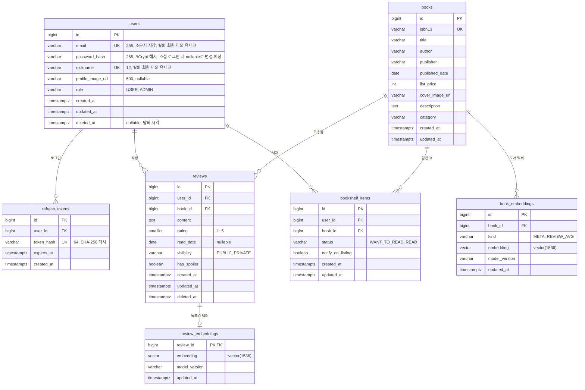
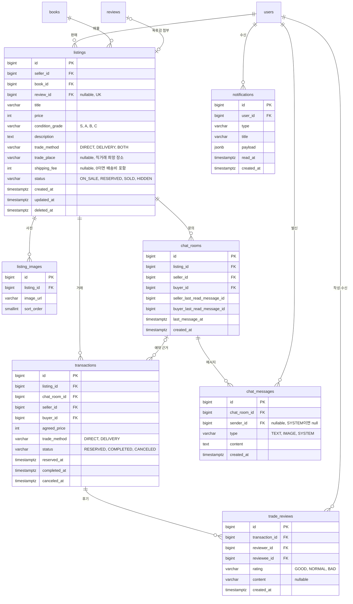

# ERD 설계

> 두독(DooDok) 데이터베이스 설계 문서 (v2.2)
> DB: PostgreSQL 17 + pgvector · ORM: Spring Data JPA
>
> MVP에 필요한 테이블을 먼저 잡았다. 기능을 붙이면서 테이블을 추가하고, 변경 내용은 이 문서의 변경 이력에 남긴다.

## 1. 전체 구조

| 영역 | 테이블 | 역할 |
|---|---|---|
| 회원 | `users`, `refresh_tokens` | 회원, 로그인 토큰 |
| 도서·독서 | `books`, `reviews`, `bookshelf_items` | ISBN 기준 도서 마스터, 독후감, 내 서재 |
| 거래 | `listings`, `listing_images`, `transactions`, `trade_reviews` | 판매글, 사진, 거래, 거래 후기 |
| 소통 | `chat_rooms`, `chat_messages`, `notifications` | 1:1 채팅, 알림 |
| AI | `book_embeddings`, `review_embeddings` | 추천용 벡터 |
| (테이블 밖) | Redis | 이메일 인증 코드, signupToken, 요청 횟수 제한 (4절 참고) |

중심은 **`books`**다. 같은 책의 판매글, 독후감, 서재 항목이 모두 하나의 `books` 행에 모이고, 추천·시세·입고 알림이 여기서 출발한다.

## 2. ERD

### 2-1. 회원 · 도서 · 독서



### 2-2. 거래 · 채팅 · 알림



## 3. 테이블별 핵심 규칙

### 회원
**users / refresh_tokens**
- `email`, `nickname`은 **탈퇴하지 않은 회원 중에서** 유니크하다. (`WHERE deleted_at IS NULL` 부분 유니크 인덱스) 탈퇴 후 같은 이메일로 다시 가입할 수 있다.
- 이메일은 소문자로 바꿔 저장한다.
- **가입 전 이메일 인증**을 마친 이메일만 저장된다. 인증 코드와 signupToken은 DB가 아니라 Redis에 TTL로 저장한다. (아래 '테이블 밖 저장소' 참고)
- `password_hash`는 현재 NOT NULL이다. 구글·카카오 로그인으로만 가입한 회원은 비밀번호가 없으므로, **소셜 로그인 기능에서 새 마이그레이션(V3 이후)으로 nullable로 바꾼다.** (V2는 이미 적용되어 수정하지 않는다)
- 탈퇴는 `deleted_at`으로 소프트 삭제한다. (거래·채팅 기록에서 상대방 정보가 사라지지 않도록)
- 리프레시 토큰은 원문 대신 해시만 저장한다. 재발급과 로그아웃으로 폐기된 행은 삭제하고, 사용되지 않고 만료된 행은 매시간 정리한다.

### 도서 · 독서
**books**
- 외부 도서 API(카카오, 알라딘) 정보를 **ISBN-13 기준으로 한 번만** 저장한다.
- 판매글·독후감·서재 담기 시 ISBN으로 먼저 조회하고, 없을 때만 외부 API를 호출한다.

**reviews (독후감)**
- 같은 책에 독후감을 여러 번 쓸 수 있다. `read_date`로 언제 읽은 기록인지 구분한다.
- `PRIVATE` 글은 본인만 보고, 추천 근거 문장으로도 노출하지 않는다.

**bookshelf_items (내 서재)**
- `(user_id, book_id)` 유니크. 한 책은 서재에 한 번만 담긴다.
- `WANT_TO_READ`(읽고 싶은 책), `READ`(읽은 책)
- `notify_on_listing = true`면 그 책의 판매글이 새로 올라올 때 알림을 받는다. (입고 알림)
- 독후감을 쓰면 해당 책을 `READ`로 자동 등록·변경한다.
- 추천 결과 중 판매 중 매물이 없는 책은 "서재에 담고 알림 받기"로 연결한다.

### 거래
**listings (판매글)**
- 거래 방법은 판매자가 고른다.
  - `DIRECT`: 직거래만. `trade_place`에 희망 장소를 자유롭게 적는다. (동네 인증은 하지 않음)
  - `DELIVERY`: 택배만. `shipping_fee`에 배송비를 적고, `0`이면 배송비 포함 가격이다.
  - `BOTH`: 둘 다 가능
- 배송 추적은 하지 않는다. 송장 번호 등은 채팅으로 주고받는다.
- 독후감 첨부(`review_id`)는 선택이며, 독후감 하나는 판매글 하나에만 첨부할 수 있다.
- `condition_grade`: S(새 책 수준), A(사용감 적음), B(밑줄·필기 일부), C(손상 있음)

**chat_rooms / chat_messages**
- 판매글 하나에 구매 희망자마다 채팅방 하나. `(listing_id, buyer_id)` 유니크.
- 읽음 처리는 방마다 마지막으로 읽은 메시지 ID로 관리한다. 메시지마다 읽음 여부를 저장하는 것보다 쓰기가 훨씬 적다.
- 예약·거래 완료·취소 같은 안내는 `SYSTEM` 메시지로 채팅방에 남긴다.
- 이미지 메시지는 S3에 올린 URL을 `content`에 저장한다.

**transactions (거래)**
- **판매자가 채팅한 구매자 중 한 명을 골라 예약**한다. 어떤 대화에서 예약됐는지 `chat_room_id`로 남긴다.
- 실제 거래 방법(`DIRECT`/`DELIVERY`)을 예약할 때 정한다. 판매글이 `BOTH`여도 거래는 하나로 확정된다.
- 예약이 취소되면 다른 사람과 다시 예약할 수 있어, 판매글 하나에 거래가 여러 번 생길 수 있다.
- 대신 **진행 중·완료된 거래는 판매글당 하나**만 허용한다.
  ```sql
  CREATE UNIQUE INDEX uk_transactions_active_listing
      ON transactions (listing_id)
      WHERE status IN ('RESERVED', 'COMPLETED');
  ```
- 판매자가 두 채팅방에서 거의 동시에 예약을 눌러도 하나만 성공해야 한다. 조건부 UPDATE(`WHERE status = 'ON_SALE'`)로 먼저 막고, 위 인덱스로 한 번 더 보장한다.
- `agreed_price`: 판매글 가격과 실제 거래 가격이 다를 수 있어 따로 저장한다. 시세 계산에 이 값을 쓴다.

**trade_reviews (거래 후기)**
- 거래가 `COMPLETED`일 때만 작성할 수 있다.
- `(transaction_id, reviewer_id)` 유니크. 판매자와 구매자가 서로 한 번씩 남긴다.
- 평가는 `GOOD / NORMAL / BAD` 세 단계로 단순하게 두고, 프로필에 "거래 n회, 좋아요 n%"로 보여준다.

### 소통
**notifications**
- 채팅, 예약, 거래 완료, 거래 후기, 입고 알림을 한 테이블에서 관리한다.
- 종류마다 필요한 값이 달라 `payload`는 jsonb로 둔다. (예: `{ "listingId": 31, "chatRoomId": 5 }`)
- 실시간 전달은 SSE로 하고, 접속하지 않은 동안 쌓인 알림은 목록 API로 조회한다.

### AI
**book_embeddings / review_embeddings**
- 벡터는 행마다 6KB가 넘어 원본 테이블과 분리했다. 일반 조회가 가벼워지고, 모델을 바꿀 때 `model_version` 기준으로 교체할 수 있다.
- `book_embeddings.kind`
  - `META`: 도서 소개글로 만든 벡터. 독후감이 없는 책도 추천 가능 (콜드 스타트 대응)
  - `REVIEW_AVG`: 그 책의 공개 독후감 벡터 평균
- 임베딩은 독후감·도서 저장 후 비동기로 생성한다.
- 같은 책에 독후감이 여러 개면 취향 계산에서 그 책이 과하게 반영될 수 있으므로, **책마다 가장 최근 독후감만** 사용한다.
- 서재의 `WANT_TO_READ` 책도 취향 신호로 함께 쓴다.

## 4. 구현 현황 (Flyway 마이그레이션)

실제 스키마의 기준은 `backend/src/main/resources/db/migration/`의 SQL이다. 이 절은 구현된 테이블의 DDL을 옮겨둔 것이고, 마이그레이션을 추가할 때 함께 갱신한다.

| 버전 | 파일 | 내용 |
|---|---|---|
| V1 | `V1__enable_pgvector.sql` | pgvector 확장 활성화 |
| V2 | `V2__create_users.sql` | `users` |
| V3 | `V3__create_refresh_tokens.sql` | `refresh_tokens` |
| V4 | `V4__index_refresh_tokens_expiration.sql` | 리프레시 토큰 만료 시각 인덱스 |
| V5 | `V5__create_books.sql` | `books` |

**진행 상황**: `users`, `refresh_tokens`, `books` 완료 / 나머지 테이블은 기능을 만들 때 추가

```sql
-- V1__enable_pgvector.sql
CREATE EXTENSION IF NOT EXISTS vector;

-- V2__create_users.sql
CREATE TABLE users (
    id                BIGINT GENERATED BY DEFAULT AS IDENTITY PRIMARY KEY,
    email             VARCHAR(255) NOT NULL,
    password_hash     VARCHAR(255) NOT NULL,
    nickname          VARCHAR(12)  NOT NULL,
    profile_image_url VARCHAR(500),
    role              VARCHAR(20)  NOT NULL,
    created_at        TIMESTAMPTZ  NOT NULL,
    updated_at        TIMESTAMPTZ  NOT NULL,
    deleted_at        TIMESTAMPTZ,
    CONSTRAINT ck_users_role CHECK (role IN ('USER', 'ADMIN'))
);

-- 탈퇴(소프트 삭제)한 회원은 제외하고 유니크를 건다. 탈퇴 후 같은 이메일·닉네임으로 다시 가입할 수 있다.
-- 인덱스 이름은 AuthService에서 중복 종류를 구분하는 데 쓰므로 바꾸지 않는다.
CREATE UNIQUE INDEX uk_users_email ON users (email) WHERE deleted_at IS NULL;
CREATE UNIQUE INDEX uk_users_nickname ON users (nickname) WHERE deleted_at IS NULL;

-- V3__create_refresh_tokens.sql
CREATE TABLE refresh_tokens (
    id BIGINT GENERATED BY DEFAULT AS IDENTITY PRIMARY KEY,
    user_id BIGINT NOT NULL REFERENCES users (id) ON DELETE CASCADE,
    token_hash VARCHAR(64) NOT NULL UNIQUE,
    expires_at TIMESTAMPTZ NOT NULL,
    created_at TIMESTAMPTZ NOT NULL DEFAULT CURRENT_TIMESTAMP
);

CREATE INDEX idx_refresh_tokens_user_id ON refresh_tokens (user_id);

-- V4__index_refresh_tokens_expiration.sql
CREATE INDEX idx_refresh_tokens_expires_at ON refresh_tokens (expires_at);

-- V5__create_books.sql
-- 외부 도서 API 정보를 ISBN-13 기준으로 한 번만 저장한다. 판매글·독후감·서재가 모두 이 행을 가리킨다.
CREATE TABLE books (
    id              BIGINT GENERATED BY DEFAULT AS IDENTITY PRIMARY KEY,
    isbn13          VARCHAR(13)  NOT NULL,
    title           VARCHAR(500) NOT NULL,
    author          VARCHAR(500),
    publisher       VARCHAR(255),
    published_date  DATE,
    list_price      INT,
    cover_image_url VARCHAR(1000),
    description     TEXT,
    category        VARCHAR(100),
    created_at      TIMESTAMPTZ  NOT NULL,
    updated_at      TIMESTAMPTZ  NOT NULL,
    CONSTRAINT uk_books_isbn13 UNIQUE (isbn13),
    CONSTRAINT ck_books_isbn13 CHECK (isbn13 ~ '^[0-9]{13}$')
);
```

- `books`: 카카오 API는 분류를 주지 않아 `category`는 비어 있다. (알라딘 연동 시 채운다) `description`은 카카오가 주는 소개글 일부다.

**JPA 매핑**: `domain/user/User.java`, `domain/book/Book.java` (`BaseTimeEntity` 상속으로 `created_at`, `updated_at` 자동 기록). `ddl-auto: validate`라서 엔티티와 이 DDL이 다르면 앱이 시작되지 않는다.

### 테이블 밖 저장소 (Redis)
로그인 시도 제한은 `auth:login:account:{sha256(normalizedEmail)}`(10회)과
`auth:login:ip:{sha256(ip)}`(50회)를 사용한다. 카운터 증가와 최초 15분 TTL 설정은 Lua로 원자 처리한다.

몇 분만 필요한 데이터는 테이블 대신 Redis에 TTL을 걸어 저장한다. 만료되면 자동으로 지워져 정리 작업이 필요 없다. (`domain/auth/EmailVerificationService`)
횟수 카운터는 `INCR`과 첫 `EXPIRE`를 Lua 스크립트로 묶어, TTL 없는 카운터가 남지 않게 한다.

| 키 | 값 | TTL | 용도 |
|---|---|---|---|
| `email-verification:code:{email}` | 인증 코드의 SHA-256 해시 | 5분 | 코드 확인 |
| `email-verification:attempts:{email}` | 틀린 횟수 | 5분 | 5회 초과 시 코드 폐기 |
| `email-verification:cooldown:{email}` | `1` | 60초 | 재발송 쿨다운 |
| `email-verification:daily:{email}` | 발송 횟수 | 1일 | 하루 10회 제한 |
| `email-verification:ip:{ip}` | 요청 횟수 | 1시간 | IP당 20회 제한 (가입 여부 대량 조회 방지) |
| `signup-token:{token}` | 인증된 이메일 | 10분 | 회원가입 시 이메일 확인, 가입 성공 후 삭제 |

## 5. 공통 원칙

- **PK**: `bigint` 자동 증가(`IDENTITY`)
- **시간**: `timestamptz`로 저장, 표시만 KST
- **금액**: 원 단위 `int`
- **상태값**: `varchar` + JPA `EnumType.STRING`
- **소프트 삭제**: `users`, `reviews`, `listings`
- **소프트 삭제 + 유니크**: 유니크가 필요한 컬럼은 `WHERE deleted_at IS NULL` 부분 유니크 인덱스로 건다. (삭제된 행 때문에 같은 값을 다시 못 쓰는 문제 방지)
- **생성·수정 시각**: 엔티티는 `BaseTimeEntity`를 상속해 `created_at`, `updated_at`을 자동으로 채운다.

## 6. 기본 인덱스

| 테이블 | 인덱스 | 용도 |
|---|---|---|
| `users` | `email` (부분 UK, `deleted_at IS NULL`) | 가입 중복 방지, 로그인 조회 |
| `users` | `nickname` (부분 UK, `deleted_at IS NULL`) | 닉네임 중복 방지 |
| `books` | `isbn13` (UK) | ISBN 조회 |
| `reviews` | `(book_id, visibility, created_at)` | 책 상세의 독후감 목록 |
| `reviews` | `(user_id, created_at)` | 내 독후감 목록 |
| `bookshelf_items` | `(user_id, book_id)` (UK) | 중복 담기 방지 |
| `bookshelf_items` | `(book_id) WHERE notify_on_listing` | 매물 등록 시 알림 대상 조회 |
| `listings` | `(status, created_at)` | 판매 중 매물 최신순 |
| `listings` | `(book_id, status)` | 책별 판매 중 매물, 추천 결과 재정렬 |
| `chat_rooms` | `(listing_id, buyer_id)` (UK) | 중복 채팅방 방지 |
| `chat_rooms` | `(seller_id, last_message_at)`, `(buyer_id, last_message_at)` | 내 채팅방 목록 |
| `chat_messages` | `(chat_room_id, id)` | 메시지 최신순 페이지네이션 |
| `transactions` | `listing_id` (부분 UK) | 이중 거래 방지 |
| `trade_reviews` | `(transaction_id, reviewer_id)` (UK) | 중복 후기 방지 |
| `trade_reviews` | `(reviewee_id, created_at)` | 프로필의 받은 후기 |
| `notifications` | `(user_id, read_at, created_at)` | 안 읽은 알림 수, 알림 목록 |
| `book_embeddings` | `embedding` (HNSW, cosine) | 유사 도서 검색 |

## 7. 이후 추가할 테이블

| 단계 | 테이블 | 용도 |
|---|---|---|
| 소셜 로그인 | (`users` 변경) | `password_hash` NOT NULL 제거: `ALTER TABLE users ALTER COLUMN password_hash DROP NOT NULL` |
| 소셜 로그인 | `user_social_accounts` | 회원과 구글·카카오 계정 연결 (`user_id`, `provider`, `provider_user_id`). `(provider, provider_user_id)` 유니크, `(user_id, provider)` 유니크. 한 회원이 자체 계정과 여러 소셜 계정을 함께 연결할 수 있다 |
| 캐시·성능 | (Redis Sorted Set) | 인기 매물·인기 도서 순위. 테이블 없이 Redis로 집계 |
| 캐시·성능 | (집계 쿼리 + 캐시) | 도서별 시세: `transactions.agreed_price` 집계 |
| 커뮤니티 | `review_likes` | 독후감 공감 |
| 운영 | `reports`, `user_blocks` | 신고, 차단 (관리자 기능) |
| AI 추천 | `user_taste_vectors` | 독후감·서재 기반 취향 벡터 |
| AI 추천 | `recommendation_logs` | 추천 노출·클릭 기록, 방식별 비교 |
| AI 리포트 | `reading_reports` | 월간 독서 리포트 (통계와 LLM 문장 분리 저장) |
| AI 공통 | `ai_jobs` | AI 호출 상태·토큰·지연·실패 기록 |

## 8. 범위에서 제외한 것

- **결제(PG 연동)**: 개인 간 거래로 두고, 거래 상태 관리에 집중한다.
- **배송 추적**: 송장 번호는 채팅으로 주고받는다.
- **동네 인증·위치 기반 검색**: 직거래 장소는 판매자가 자유롭게 적는다.

## 변경 이력

| 날짜 | 내용 |
|---|---|
| 2026-11-15 | v1 기본 구조 작성. 같은 책에 독후감 여러 개 허용, `read_date` 추가 |
| 2026-11-15 | v2 채팅·알림·거래 후기·내 서재 추가. 거래 방법(직거래/택배) 선택, 판매자가 채팅 상대 중 예약자 선택 |
| 2026-11-17 | v2.1 `users` 구현(`V2__create_users.sql`). 이메일·닉네임 유니크를 탈퇴 회원 제외 부분 인덱스로 변경, 이메일 소문자 저장. 다이어그램에 컬럼 길이·규칙 표시, 4절 구현 현황(DDL) 추가 |
| 2026-11-17 | v2.2 가입 전 이메일 인증 규칙과 Redis 키 구조 추가. 이후 추가할 테이블에 `user_social_accounts`, 소셜 로그인 때 `password_hash` nullable 변경 예정 |
| 2026-11-18 | Redis 키에 IP별 요청 횟수 추가, 카운터는 Lua로 원자 처리. 4절 DDL을 V2 파일과 글자 그대로 맞춤. 1절 전체 구조에 Redis 표시 |
| 2026-11-27 | `books` 구현(`V5__create_books.sql`). ISBN-13 형식 CHECK 제약, 카카오 기준이라 `category`는 비워 둠 |
