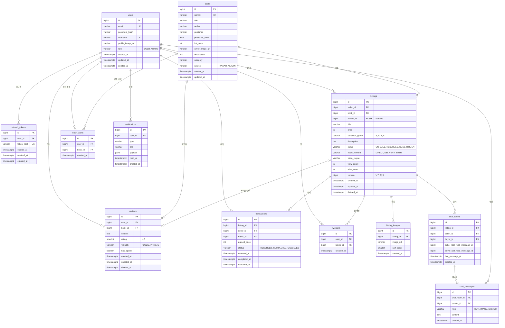

# ERD 설계

> 두독(DooDok) 데이터베이스 설계 문서
> DB: PostgreSQL 17 + pgvector · ORM: Spring Data JPA

## 1. 전체 구조

테이블은 역할에 따라 네 영역으로 나눈다.

| 영역 | 테이블 | 역할 |
|---|---|---|
| 회원 | `users`, `refresh_tokens` | 회원, 로그인 토큰 |
| 도서·독후감 | `books`, `reviews` | ISBN 기준 도서 마스터, 독후감 |
| 거래 | `listings`, `listing_images`, `transactions`, `wishlists`, `book_alerts`, `chat_rooms`, `chat_messages`, `notifications` | 판매글, 거래, 찜, 채팅, 알림 |
| AI | `book_embeddings`, `review_embeddings`, `user_taste_vectors`, `recommendation_logs`, `reading_reports`, `ai_jobs` | 추천, 독서 리포트, AI 작업 기록 |

중심은 **`books`**다. 같은 책의 여러 판매글과 여러 독후감이 하나의 `books` 행에 모이고, 시세·추천·리포트가 모두 여기서 출발한다.

## 2. ERD

### 2-1. 회원 · 도서 · 독후감 · 거래



### 2-2. AI (추천 · 독서 리포트)

```mermaid
erDiagram
    books ||--o{ book_embeddings : "도서 벡터"
    reviews ||--o| review_embeddings : "독후감 벡터"
    users ||--o| user_taste_vectors : "취향 벡터"
    users ||--o{ recommendation_logs : "추천 노출"
    books ||--o{ recommendation_logs : "추천된 책"
    users ||--o{ reading_reports : "월간 리포트"
    users ||--o{ ai_jobs : "요청"

    book_embeddings {
        bigint id PK
        bigint book_id FK
        varchar kind "META, REVIEW_AVG"
        vector embedding "vector(1536)"
        varchar model_version
        varchar source_hash
        timestamptz updated_at
    }

    review_embeddings {
        bigint review_id PK,FK
        vector embedding "vector(1536)"
        varchar model_version
        varchar content_hash
        timestamptz updated_at
    }

    user_taste_vectors {
        bigint user_id PK,FK
        vector embedding "vector(1536)"
        int review_count
        varchar model_version
        timestamptz updated_at
    }

    recommendation_logs {
        bigint id PK
        bigint user_id FK
        bigint book_id FK
        bigint listing_id FK "nullable"
        varchar strategy "CO_TRADE, EMBEDDING, HYBRID, CHAT"
        double score
        smallint position
        varchar request_id
        timestamptz shown_at
        timestamptz clicked_at
    }

    reading_reports {
        bigint id PK
        bigint user_id FK
        char year_month "2026-11"
        jsonb stats "SQL 계산 결과"
        jsonb content "LLM 생성 결과"
        varchar status "GENERATED, FALLBACK"
        varchar model_version
        timestamptz created_at
    }

    ai_jobs {
        bigint id PK
        bigint user_id FK "nullable"
        varchar job_type "REVIEW_EMBEDDING, BOOK_EMBEDDING, MONTHLY_REPORT, CHAT_RECOMMEND"
        bigint target_id
        varchar status "PENDING, RUNNING, SUCCEEDED, FAILED"
        smallint attempt_count
        varchar model
        int input_tokens
        int output_tokens
        int latency_ms
        text error_message
        timestamptz created_at
        timestamptz finished_at
    }
```



## 3. 테이블 상세

### 회원

**users**
- 이메일 로그인 기준. `email`, `nickname`은 유니크.
- 탈퇴는 `deleted_at`으로 소프트 삭제한다. 거래·채팅 기록에서 상대방 정보가 사라지면 안 되기 때문.

**refresh_tokens**
- 토큰 원문이 아닌 해시(`token_hash`)만 저장한다. DB가 유출돼도 토큰을 재사용할 수 없게 하기 위함.
- 로그아웃·재발급 시 `revoked_at`을 채운다. 만료 토큰은 스케줄러로 정리한다.

### 도서 · 독후감

**books**
- 외부 도서 API(카카오, 알라딘)에서 가져온 정보를 **ISBN-13 기준으로 한 번만** 저장한다.
- 판매글 등록이나 독후감 작성 시 ISBN으로 먼저 조회하고, 없으면 외부 API에서 가져와 저장한다.
- 같은 책 정보가 판매글마다 중복 저장되지 않으므로 시세 계산, 추천, 검색이 모두 `book_id` 하나로 묶인다.

**reviews (독후감)**
- `(user_id, book_id)` 유니크: **한 사람은 한 책에 독후감 하나**. 다시 읽으면 기존 글을 수정한다.
  - 같은 책의 독후감이 여러 개면 취향 벡터에 그 책이 과하게 반영되기 때문.
- `visibility = PRIVATE`인 글은 본인만 보고, 추천 근거 문장으로도 노출하지 않는다.
- `has_spoiler`는 작성자가 직접 표시한다. (이후 AI 판정으로 보조)

### 거래

**listings (판매글)**
- `review_id`는 선택 사항이며 유니크다. 독후감 하나는 판매글 하나에만 첨부할 수 있다.
  - 첨부하는 독후감은 판매자 본인의 같은 책 독후감이어야 한다. (애플리케이션에서 검증)
- `condition_grade`: S(새 책 수준), A(사용감 적음), B(밑줄·필기 일부), C(손상 있음)
- `wish_count`는 목록 정렬용 집계 컬럼. 정확한 값은 `wishlists`가 기준이다.
- `version`: 판매글 수정과 상태 변경이 동시에 일어날 때를 대비한 낙관적 락 컬럼.

**transactions (거래)**
- 한 판매글에 거래가 여러 번 생길 수 있다. (예약 → 취소 → 다른 사람이 예약)
- 대신 **진행 중이거나 완료된 거래는 판매글당 하나만** 존재해야 한다. 이를 부분 유니크 인덱스로 보장한다.
  ```sql
  CREATE UNIQUE INDEX uk_transactions_active_listing
      ON transactions (listing_id)
      WHERE status IN ('RESERVED', 'COMPLETED');
  ```
- `agreed_price`: 판매글 가격과 실제 거래 가격이 다를 수 있어 따로 저장한다. 시세 계산에는 이 값을 쓴다.

**wishlists / book_alerts**
- `wishlists`: 판매글 찜. `(user_id, listing_id)` 유니크.
- `book_alerts`: 아직 매물이 없는 책에 "매물 등록 시 알림"을 거는 기능. `(user_id, book_id)` 유니크.
  - 추천했지만 판매 중인 매물이 없는 책을 여기로 연결한다.

**chat_rooms / chat_messages**
- 판매글 하나에 구매 희망자마다 채팅방 하나. `(listing_id, buyer_id)` 유니크.
- 읽음 처리는 방마다 `seller_last_read_message_id`, `buyer_last_read_message_id`로 관리한다. 메시지마다 읽음 여부를 저장하는 것보다 쓰기가 훨씬 적다.
- `chat_rooms.seller_id`는 `listings.seller_id`와 같지만, 채팅방 목록 조회 시 조인을 줄이기 위해 함께 저장한다.

**notifications**
- 채팅, 거래 상태 변경, 입고 알림, 리포트 생성 알림을 한 테이블에서 관리한다.
- 알림 종류마다 필요한 값이 달라 `payload`는 jsonb로 둔다.

### AI

**왜 임베딩을 별도 테이블로 분리하나**
- 1536차원 벡터는 행 하나가 6KB 이상이라, `books`·`reviews`에 두면 일반 조회까지 무거워진다.
- 임베딩 모델을 바꾸면 전체를 다시 만들어야 하는데, 별도 테이블이면 `model_version` 기준으로 교체할 수 있다.
- 임베딩은 비동기로 만들어지므로 "아직 없음" 상태를 테이블 행의 존재 여부로 자연스럽게 표현할 수 있다.

**book_embeddings**
- `kind = META`: 출판사 소개글·카테고리·저자로 만든 벡터. 독후감이 없는 책도 첫날부터 추천할 수 있다. (콜드 스타트 대응)
- `kind = REVIEW_AVG`: 그 책에 달린 공개 독후감 벡터의 평균. "독자들이 느낀 결"을 나타낸다.
- `(book_id, kind, model_version)` 유니크.
- `source_hash`: 원문이 바뀌지 않았으면 임베딩을 다시 만들지 않기 위한 값.

**review_embeddings**
- 독후감 저장 → AI 작업 등록 → 비동기로 임베딩 생성 → 저장.
- `content_hash`로 내용이 실제로 바뀌었을 때만 다시 만든다.

**user_taste_vectors**
- 사용자가 쓴 독후감 벡터의 평균. 새 독후감이 생기면 전체를 다시 계산하지 않고 평균을 갱신한다.
  - `새 평균 = (기존 평균 × review_count + 새 벡터) / (review_count + 1)`
- 독후감이 없는 신규 사용자는 가입 시 고른 책 3권의 `META` 벡터 평균으로 시작한다.

**recommendation_logs**
- 어떤 방식(`strategy`)으로 어떤 책을 몇 번째(`position`)에 보여줬고 클릭했는지 기록한다.
- 추천 방식별 클릭률을 비교하는 근거 데이터. `request_id`로 한 번의 추천 요청을 묶는다.

**reading_reports**
- `(user_id, year_month)` 유니크. 월 1회 배치로 만들고, 조회할 때는 LLM을 호출하지 않는다.
- `stats`: 읽은 권수, 장르 비율, 거래 수 등 **SQL로 계산한 숫자**.
- `content`: 취향 키워드, 요약, 다음 달 추천 등 **LLM이 만든 문장**. JSON 스키마 검증을 통과한 결과만 저장한다.
- LLM이 계속 실패하면 `status = FALLBACK`으로 통계만 담긴 리포트를 저장한다.

**ai_jobs**
- 모든 AI 호출(임베딩, 리포트, 대화형 추천)을 한 곳에 기록한다.
- 재시도 횟수, 토큰 사용량, 응답 시간, 실패 사유를 남겨 **비용과 품질을 측정하는 근거**로 쓴다.
- `job_type + target_id`로 어떤 독후감·책·리포트에 대한 작업인지 찾는다.

## 4. 인덱스

| 테이블 | 인덱스 | 용도 |
|---|---|---|
| `books` | `isbn13` (UK) | ISBN 조회 |
| `books` | `title` (pg_trgm GIN) | 제목 부분 검색 |
| `reviews` | `(user_id, book_id)` (UK) | 1인 1독후감 |
| `reviews` | `(book_id, visibility, created_at)` | 책 상세의 독후감 목록 |
| `listings` | `(status, created_at DESC)` | 판매 중 매물 최신순 |
| `listings` | `(book_id, status)` | 책별 판매 중 매물, 추천 결과 재정렬 |
| `listings` | `(seller_id, created_at DESC)` | 내 판매 목록 |
| `transactions` | `listing_id` (부분 UK, RESERVED/COMPLETED) | 이중 거래 방지 |
| `transactions` | `(buyer_id, status)` | 내 구매 목록, 함께 거래된 책 집계 |
| `wishlists` | `(user_id, listing_id)` (UK) | 중복 찜 방지 |
| `chat_rooms` | `(listing_id, buyer_id)` (UK) | 중복 채팅방 방지 |
| `chat_messages` | `(chat_room_id, id DESC)` | 메시지 최신순 페이지네이션 |
| `book_embeddings` | `embedding` (HNSW, cosine) | 유사 도서 검색 |
| `review_embeddings` | `embedding` (HNSW, cosine) | 유사 독후감 검색 |
| `reading_reports` | `(user_id, year_month)` (UK) | 월별 리포트 중복 방지 |
| `ai_jobs` | `(status, created_at)` | 대기 작업 조회 |

## 5. 설계 원칙

- **PK**: 모든 테이블 `bigint` 자동 증가(`IDENTITY`).
- **시간**: `timestamptz`로 저장해 서버 시간대와 무관하게 한다. 표시만 KST로 한다.
- **금액**: 원 단위 `int`. 소수가 없으므로 실수형을 쓰지 않는다.
- **상태값**: DB enum 대신 `varchar` + JPA `EnumType.STRING`. 값을 추가할 때 마이그레이션이 단순하다.
- **소프트 삭제**: `users`, `reviews`, `listings`만 적용한다. 거래·채팅 기록에서 참조되기 때문.
- **동시성**: 판매글 상태 변경은 조건부 UPDATE(`WHERE status = 'ON_SALE'`)로 먼저 막고, 부분 유니크 인덱스로 한 번 더 보장한다.

## 6. 핵심 흐름별 데이터 변화

**판매글 등록**
1. ISBN으로 `books` 조회 → 없으면 외부 API에서 가져와 저장 (+ `book_embeddings(META)` 작업 등록)
2. `listings`, `listing_images` 저장
3. 그 책에 `book_alerts`를 건 사용자에게 `notifications` 생성

**구매 예약**
1. `UPDATE listings SET status = 'RESERVED' WHERE id = ? AND status = 'ON_SALE'`
2. 영향받은 행이 1개일 때만 `transactions(RESERVED)` 생성
3. 동시에 두 요청이 와도 하나만 성공한다. 이 동작을 Testcontainers 동시성 테스트로 검증한다.

**독후감 작성**
1. `reviews` 저장
2. `ai_jobs(REVIEW_EMBEDDING)` 등록 → 비동기로 `review_embeddings` 생성
3. `user_taste_vectors` 평균 갱신, 해당 책의 `book_embeddings(REVIEW_AVG)` 갱신

**추천 조회**
1. `user_taste_vectors`와 가까운 `book_embeddings`를 pgvector로 검색
2. 함께 거래된 책 점수(`transactions` 집계)와 합산
3. 판매 중인 `listings`가 있는 책만 남겨 가격·상태로 재정렬
4. 노출 결과를 `recommendation_logs`에 기록

## 7. 이후 단계에서 추가할 것

- 대화형 추천 대화 기록 (`ai_chat_sessions`, `ai_chat_messages`)
- 신고·차단 (`reports`, `user_blocks`)
- 거래 후기·매너 평가 (`trade_reviews`)
